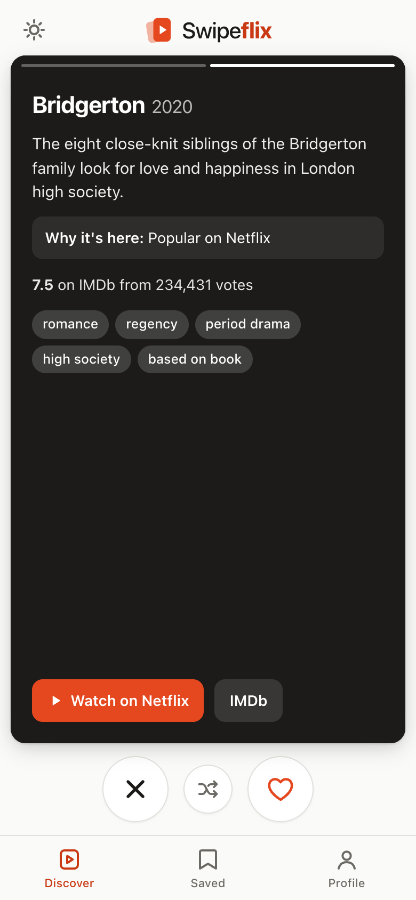
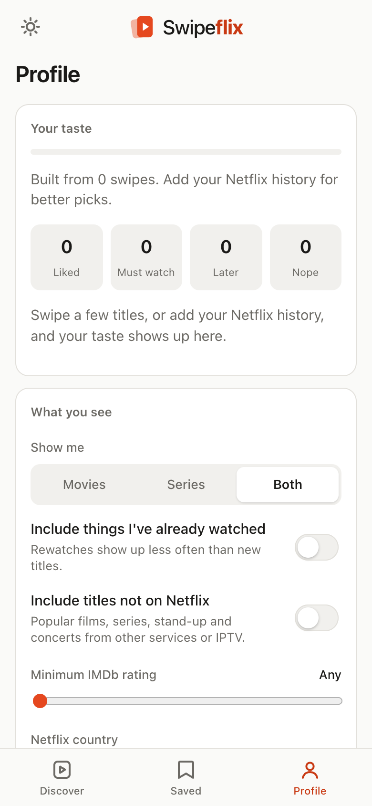

# Swipeflix 🍿

**Tinder for your Netflix queue.** A local app that reads your Netflix viewing history, looks at what's on Netflix in your country along with IMDb ratings, and deals you one title at a time. **Swipe right** and you'll see more like it. **Swipe left** and it never comes back.

**Your history and swipes stay on your own phone.** Recommendations are worked out there, so your viewing history is never sent to a server, and Swipeflix never asks for, sees or stores a Netflix password. No account to make, no tracking. Free to run.

<p align="center">  </p>

| Swipe | Button | Key | What it does |
|---|---|---|---|
| → right | heart | `→` | **Like**: more titles like this one |
| ← left | ✕ | `←` | **Nope**: never shown again, and similar titles show up less |
| ↑ up | n/a | `↑` or `Enter` | **Must watch**: a strong like, saved to *Saved → Must watch* |
| ↓ down | n/a | `↓` | **Later**: not now. Hidden from the deck and kept in *Saved → Later* to decide on later |
| n/a | rewind (after a swipe) | `Backspace` | **Rewind**: undo your last swipe |
| n/a | shuffle | `L` | **I'm feeling lucky**: one highly rated pick that fits your taste |
| tap left / right | n/a | `Space` | Flip between the poster and the details page (description, why it's here, cast, links) |

Other controls:
- **Profile** is where everything lives: your taste, what you see (Movies / Series / Both, rewatches, titles not on Netflix, minimum IMDb rating, Netflix country), your history, your data and the reset buttons. Today's picks is the sun icon at the top left.
- **Rewatches**: when "Include things I've already watched" is on, they come back about **3× less often** than new titles and carry a "Rewatch" chip.
- **Titles not on Netflix**: switch on "Include titles not on Netflix" to also see popular films, series, stand-up and concerts you might watch on another service or IPTV. They're marked "Not on Netflix" and link to JustWatch to find where to stream them.
- **Stand-up and concerts** are first-class: they're listed for every country, recognised as their own kind of watch, and weighed heavily if your history is full of them.
- **Reset**: *Profile → Reset my swipes* clears your swipes. *Reset everything* also clears your imported history from this device.

## How it works (and why it costs nothing)

- **Your phone does the recommending.** It downloads your country's Netflix catalog once (a few hundred KB, cached for offline use) and scores it against your history and swipes *on the phone*. Your history and swipes are never sent to a server.
- **A scheduled GitHub job builds the catalogs** (every day, free) from TMDB and IMDb's ratings and publishes them as static files.
- **A tiny Cloudflare Worker (free plan)** serves the app and those files, holds one-time codes for moving data between devices, and rate-limits both.

No paid Cloudflare plan, no R2, no credit card: only a free Cloudflare account, a free GitHub account and a free TMDB key.

## Set it up (about 15 minutes, all free)

### 1. Get a TMDB key
Create a free account at <https://www.themoviedb.org/signup>, then request an API key at <https://www.themoviedb.org/settings/api> (choose *Developer*, personal use; for the application URL use your repo's address). Players never need a TMDB account: only you, the owner, use this key.

### 2. Build the catalogs on GitHub
1. In your repo: *Settings → Secrets and variables → Actions → New repository secret*. Name it `TMDB_API_KEY` and paste the key.
2. Add the workflow (see the note below), then open the *Actions* tab → **catalogs** → *Run workflow*. The first run takes 10 to 20 minutes. After that it runs every night and only fetches what's new.
3. It publishes the files to a branch called `data`. The repo must be public so the Worker can read them. (Prefer private? Run `TMDB_API_KEY=... npm run catalogs` yourself and host the `data-out/` folder anywhere, then change `CATALOG_BASE` in `wrangler.jsonc`.)

Which countries? All of those listed in `public/lib/regions.js`. A country with no catalog yet simply shows the built-in 100-title sample.

### 3. Deploy the app to Cloudflare
```bash
npm install
npx wrangler login          # opens your browser once
npm run deploy              # prints your URL: https://swipeflix.<you>.workers.dev
```
That's it for the app. Everything it uses (static files, one Durable Object) is on Cloudflare's free plan and needs no payment method.

### 4. Install it on your phone
Open the URL on the phone, then **Add to Home Screen** (iPhone: Safari → Share → Add to Home Screen). Phones only install web apps over HTTPS, which Cloudflare provides. For your own domain, add a custom domain to the Worker in the Cloudflare dashboard.

> **Adding the GitHub workflow:** GitHub only lets a token with the `workflow` permission push files under `.github/workflows/`, so the workflow lives at `scripts/catalogs.workflow.yml` for you to copy. On GitHub choose *Add file → Create new file*, name it `.github/workflows/catalogs.yml`, paste in that file's contents and commit.

### Free-plan limits worth knowing
- Workers Free allows 100,000 requests a day and only counts calls to `/api/*`; the app itself is served as free static files. Each person makes a handful of API calls a day (a catalog download at most weekly, an occasional transfer code), so this covers a very large number of people.
- Each Worker call has 10 ms of CPU. That's why the phone does the scoring and the catalogs are built on GitHub instead of in the Worker.
- **Rate limiting is built in.** Every `/api` call goes through Cloudflare's rate limiter (60 requests a minute per visitor, set in `wrangler.jsonc`), so one client can't use up the daily quota. It works on `workers.dev` addresses, where dashboard firewall rules don't apply. If you add your own domain you can also add a WAF rate-limiting rule.

## Run it on your computer

```bash
git clone https://github.com/kkotsop/movie-recommendation.git
cd movie-recommendation
npm install
npm start            # → http://localhost:8787  (the real Cloudflare Worker runtime, running locally)
```

Requires Node 22+ (Wrangler needs it). With no catalogs published it uses the built-in sample. To try a real catalog locally: `TMDB_API_KEY=your-key REGIONS=US npm run catalogs`, then serve `data-out/` with any static server and set `CATALOG_BASE` (in `wrangler.jsonc`, or `npx wrangler dev --var CATALOG_BASE:http://localhost:9000/catalog`).

### Where each person's data lives

Each installed app keeps **its own** Netflix history, swipes and settings in the phone's browser storage, and works everything out there. The only time anything personal reaches a server is if someone chooses *Move to another device*, and then only for ten minutes until the other device collects it. There is no title lookup and no tracking. The tests check this. Consequences worth knowing:

- Clearing site data or switching phones loses it. Use **Profile → Move your data** to get a one-time code (valid once, for 10 minutes) and enter it on the other device.
- **iPhone keeps the home-screen app and Safari separate.** If you tried the app in Safari first, use *Move to another device* to carry that over to the home-screen app.
- Watched titles are matched by name against the catalogs, on the phone. Nothing is sent anywhere to do that, so a title that isn't in your country's catalog or the worldwide list simply doesn't shape your taste.

## Getting your Netflix history in

Netflix has no public API and Swipeflix never asks for your password, so history comes in as the file Netflix itself gives you:

1. On netflix.com (phone or computer) open *Account → your profile → Viewing activity* and tap **Download all**. You get `NetflixViewingHistory.csv`.
2. In Swipeflix choose that file. The first time you open the app, and whenever you tap *Upload viewing history* in Profile, a short four-step walkthrough shows exactly where to click, then lets you pick the file.

The file is read on your phone and stays there. The parser handles US and European date formats and groups episodes into shows ("Dark: Season 2: ..." becomes *Dark*). It recognises season markers in English, Greek, German, French, Spanish, Italian and other languages.

> Titles are matched by name, in the language of your Netflix profile. A title that isn't in the catalogs (an obscure show, or one named differently) simply isn't counted.

## How Tinder works, and how Swipeflix copies it

I took Tinder apart from its public behaviour: the app and web UI, its keyboard shortcuts, and what Tinder has said publicly about its matching. This app has no Tinder code or assets.

### The UX

| Tinder | Swipeflix |
|---|---|
| A stack of full-bleed photo cards. The next card waits behind at ~95% scale and grows as you drag the top one | Same. The poster is the "photo" and the next card scales from 0.95 to 1 as you drag |
| The card follows your finger and rotates around the grab point (it tilts the opposite way if you grab the bottom half) | Same rotation rule (±22°, flipped for bottom-half grabs) |
| Green **LIKE** stamp top-left, red **NOPE** top-right, blue **SUPER LIKE** for an upward swipe. Their opacity tracks how far you've dragged | **LIKE / NOPE / MUST WATCH** stamps that work the same way |
| A swipe commits past a distance threshold **or** on a fast flick. Otherwise the card springs back | Commits past 35% of the card width or a flick faster than 0.6 px/ms. Otherwise an overshooting spring brings it back |
| The matching action button lights up while you drag | Same |
| 5-button bar: Rewind · Nope · Super Like · Like · Boost | Three buttons: Nope · I'm feeling lucky · Like, plus Rewind after a swipe. Must watch is swipe up, Later is swipe down |
| Tap the right/left of a photo to page through photos. Progress bars on top. A small bounce at the last photo | Two pages per card: the poster, then the description, why it's recommended, cast and links together |
| Name + **age** in big type, a green "Recently active" dot, then chips | Title + **year**, a green "Because you watched *Dark*" dot, then genre chips |
| Tap the bottom or ⌃ to open the full profile, with a ⌄ button to close it | Full details sheet with cast, director, keywords, IMDb link and a *Watch on Netflix* button |
| **"It's a Match!"** in script lettering over a blurred overlay | **"It's a Pick!"**, shown when *I'm feeling lucky* finds a title |
| Pulsing radar around your photo while it looks for people / when nobody is left | Same radar while the catalog builds or when you run out of titles |
| Discovery settings: distance slider, age range, "Show me" | All in Profile: Show me (Movies / Series / Both), rewatches, titles not on Netflix, minimum IMDb rating, Netflix country |
| Bottom tabs, a Likes grid with a badge, a profile with a completion ring | Discover · Saved (Liked, Must watch, Later) · Profile with a taste meter and your top genres |
| Web shortcuts: ← → ↑ ↓ Enter Space | The same, plus `Backspace` = rewind and `L` = lucky |
| Pink → orange gradient | **One solid vermilion accent** on calm neutrals, no gradients; light and dark themes |

### The algorithm

Tinder used to rank people with an **Elo-style "desirability" score**. It now says it relies mostly on **your own activity**: what you swipe on, recency, and your preferences, plus some **exploration** so the stack doesn't get stale. Cards come in **small batches**, ranked with some randomness, and anything you've swiped is never shown again.

Swipeflix does the same, but for titles, in `src/recommender.js`:

1. **Every title is a feature vector**: genres, keywords, director/creator, top cast, original language, decade, movie/series.
2. **Your taste is one vector too.** It starts from your Netflix history, where each show is weighted by **recency** (one-year half-life) × **engagement** (1 + log₂ of episodes watched). Then every swipe updates it: Like adds the title's features, Must watch adds them twice, Nope subtracts 0.7× and hides that title forever. The whole history counts about as much as 4 likes, so a few swipes quickly steer the deck.
3. **Score = cosine similarity to your taste + IMDb quality** (rating scaled around 6.5 and weighted by vote count).
4. **The deck is sampled** from the top 60 with a softmax over scores, not a fixed top 10, so it feels fresh. About 12% of cards are **exploration** picks (rated 7+ but outside your usual taste), labelled "Something different for you". Rewatches get their sampling weight × 0.3.
5. **What's trending now counts a little.** Every day the catalog build fetches TMDB's trending list and Netflix's most popular titles in your country and adds a small bonus (up to 0.15 of the score) to titles that are hot right now. Taste still wins: a trending title that doesn't fit you won't beat one that does. Cards show "Trending on Netflix now" when that's the best reason.
6. **Today's picks** (the sun tab) is five highly rated titles (7+) from your best matches, chosen with a date-seeded draw, so the list is the same all day and different tomorrow.
7. **I'm feeling lucky** looks only at unseen titles rated **7.5+ on IMDb** (dropping to 7.0, then to anything, if none are left), ranks them by fit + quality, and picks one of the top 3, so pressing it again can give a new answer.
8. **Rewind** pops the last swipe. Because the profile is rebuilt from history + swipes on every request, undo is exact.

## Data sources

- **IMDb ratings**: IMDb's official [non-commercial datasets](https://developer.imdb.com/non-commercial-datasets/) (`title.ratings.tsv.gz`, downloaded and refreshed weekly). For personal, non-commercial use only.
- **What's on Netflix in your country, posters, cast, keywords**: [TMDB](https://www.themoviedb.org/), watch provider 8 (Netflix), via JustWatch data. *This product uses the TMDB API but is not endorsed or certified by TMDB.*
- **Built-in catalog**: `public/demo-catalog.json`, with 100 Netflix originals. IDs, genres, runtimes and ratings come from the IMDb datasets. The synopses and tags were written for this app.

"Watch on Netflix" opens a Netflix search for the title, because TMDB doesn't provide Netflix's own title IDs.

## Project layout

```
public/                the app: Tinder-style UI in vanilla HTML/CSS/JS, no build step
public/lib/            recommender, history parsing, matching and the engine: they run on the phone and in the tests
public/device-store.js    your history, swipes and settings, kept on the device
public/tmdb-logo.svg   the TMDB logo, for the credits
public/sw.js           service worker (offline use, cached catalogs and posters)
public/demo-catalog.json  the built-in 100-title sample
worker/index.js        the small Cloudflare Worker: catalog files, transfer codes, rate limiting
worker/shared.js       Durable Object: transfer codes and counters against code-guessing (never anyone's history)
scripts/build-catalogs.js  builds the per-country catalogs (run daily by GitHub)
src/                   TMDB and IMDb clients and catalog discovery (used by the builder)
.github/workflows/test.yml  runs the tests
scripts/catalogs.workflow.yml  the daily catalog build (copy it to .github/workflows/)
wrangler.jsonc         Cloudflare configuration
test/                  unit, builder, Worker and browser end-to-end tests
```

```bash
npm test      # runs the real Worker locally; no Cloudflare account or TMDB key needed
```

The tests start the actual Worker in Wrangler's local runtime and a fake TMDB/IMDb server, so they cover the catalog build, the Worker, the engine, privacy guarantees and offline use. The browser tests drive Chrome, Edge or Playwright's Chromium and skip themselves if none is installed. CI (`.github/workflows/test.yml`) runs everything on Node 22 and 24.

Not affiliated with Netflix, IMDb, TMDB or Tinder.
