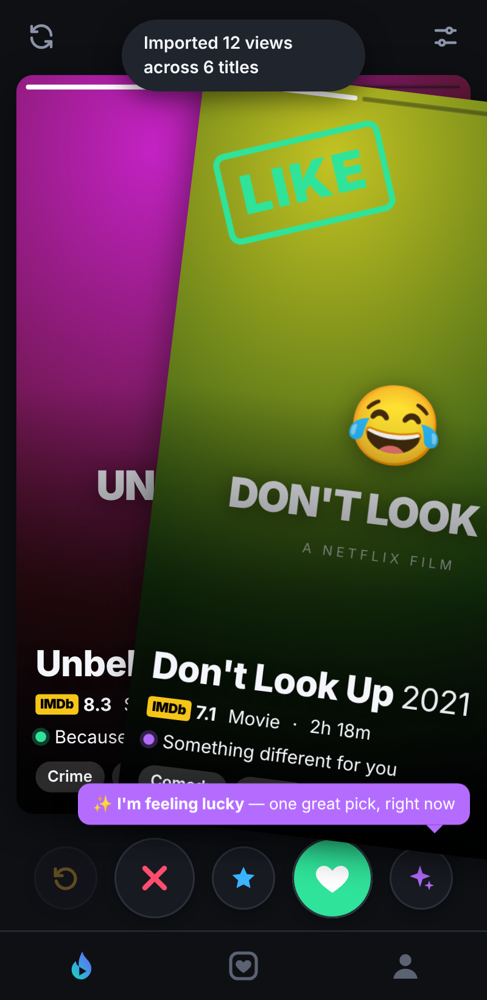
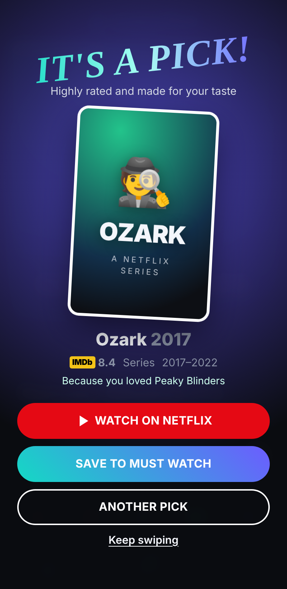
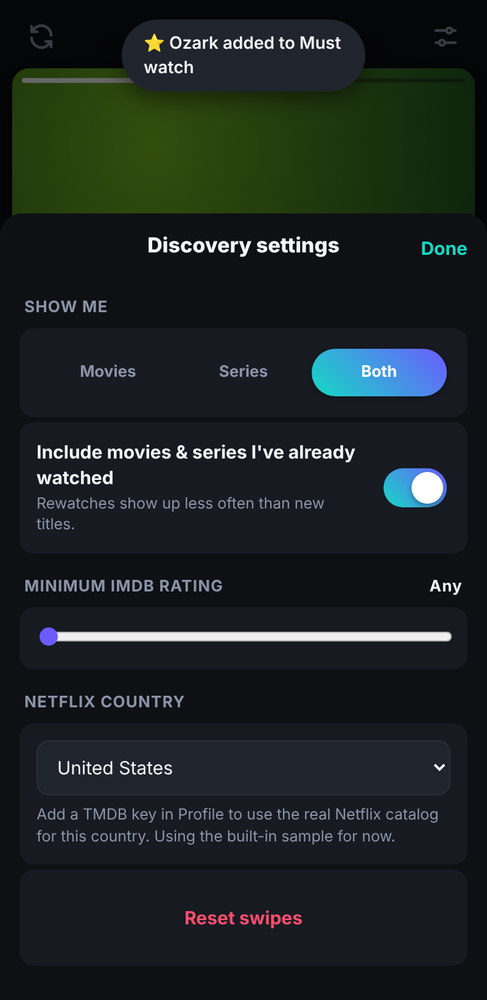

# SwipeFlick 🔥🍿

**Tinder for your Netflix queue.** A local app that reads your Netflix viewing history, looks at what's on Netflix in your country along with IMDb ratings, and deals you one title at a time. **Swipe right** and you'll see more like it. **Swipe left** and it never comes back.

Everything runs on your computer (`http://localhost:4173`). No account, no cloud, no tracking.

<p align="center">  </p>

| Swipe | Button | Key | What it does |
|---|---|---|---|
| → right | 💚 heart | `→` | **Like**: more titles like this one |
| ← left | ❌ | `←` | **Nope**: never shown again, and similar titles show up less |
| ↑ up | ⭐ star | `Enter` | **Must watch**: a strong like, saved to *Likes → Must watch* |
| — | ↺ yellow | `Backspace` | **Rewind**: undo your last swipe |
| — | ✨ purple | `L` | **I'm feeling lucky**: one highly rated pick that fits your taste |
| tap left / right | — | `Space` | Flip between the poster, synopsis and "why it's here" pages |
| tap bottom / ⌃ | — | `↑` / `↓` | Open / close full details |

Other controls:
- **Reset**: the ↺ icon in the top bar (or *Discovery settings → Reset swipes*). *Profile → Reset everything* also clears your history and logs the app out of Netflix.
- **Include movies & series I've already watched**: a switch in Discovery settings (the sliders icon). When it's on, rewatches come back about **3× less often** than new titles and carry a "↻ Rewatch" chip.
- **Show me**: Movies / Series / Both, a minimum IMDb rating, and your Netflix country.

## Quick start

```bash
git clone https://github.com/kkotsop/movie-recommendation.git
cd movie-recommendation
npm install          # installs Playwright, used only for "Log in with Netflix"
npm start            # → http://localhost:4173
```

Requires Node 20+. "Log in with Netflix" uses your installed **Chrome or Edge**. If you have neither, run `npx playwright install chromium` once.

It works straight away with a built-in catalog of 100 Netflix originals that have real IMDb ratings. To swipe through **everything on Netflix in your country, with real posters**, add a free TMDB key:

1. Create an account at <https://www.themoviedb.org/> → *Settings → API* → copy the **API Key** (or the API Read Access Token).
2. In SwipeFlick go to **Profile → Catalog**, paste the key and tap **Save key**. The first build takes about a minute. It is cached for a week.

You can also set it before starting: `TMDB_API_KEY=xxxx npm start`.

## Use it on your phone (install as an app)

SwipeFlick is a PWA: open it in your phone's browser and **Add to Home Screen** to get a full-screen app with its own icon. Phones only install PWAs, and only cache them offline, over **HTTPS**, so the server has to run somewhere that has a certificate.

1. **Run it somewhere always on.** Any host that runs a container and gives you HTTPS works (Fly.io, Render, Railway, a home server behind Tailscale or a Cloudflare Tunnel). The included `Dockerfile` is all it needs:

   ```bash
   docker build -t swipeflick .
   docker run -p 8080:8080 -v swipeflick-data:/data \
     -e ACCESS_TOKEN=pick-a-long-random-code \
     -e TMDB_API_KEY=your-free-tmdb-key \
     swipeflick
   ```

   Keep `/data` on a persistent volume (it holds your swipes, history and caches).
2. **Set `ACCESS_TOKEN`.** Without it the app only answers on localhost. With it, the whole API (your history, swipes and TMDB key) needs a login cookie. Your phone asks for the code once. `https://your-app/?t=<code>` also works as a one-tap private link. Wrong codes are rate limited. Optionally pin your domain with `ALLOWED_HOSTS=swipeflick.example.com`.
3. **Add a free TMDB key** (`TMDB_API_KEY`, or in *Profile → Catalog*). That's what brings real Netflix posters, the full catalog and the trending list.
4. **Sync your Netflix history from the phone**, no laptop and no CSV: *Sync from Netflix* shows a one-time bookmark to save. Then open *netflix.com/viewingactivity*, sign in, and tap the bookmark. It reads your list in your own signed-in browser and brings it back to SwipeFlick. Your password never leaves Netflix.

> **iPhone note:** save the bookmark in **Safari** (Chrome on iOS doesn't run bookmarklets). Android: Chrome works; type the bookmark's name in the address bar and pick it.
> The bookmark reads the same Viewing activity page as the desktop sync, so it needs the same upkeep if Netflix changes that page. It has only been tested against a stand-in page, not netflix.com itself.

## Getting your Netflix history in

Netflix has no public API, so there are two ways:

1. **Log in with Netflix** (welcome screen or *Profile → Sync Netflix*). A normal browser window opens on netflix.com. **You** type your password and pick your profile on Netflix's own page, so SwipeFlick never sees your credentials. The app then opens your *Viewing activity* page, takes the same CSV that "Download all" gives you, and closes the window. The browser session is kept in `data/browser-profile`, so the next sync won't ask you to log in again (*Reset everything* deletes it).
2. **Upload the CSV.** On netflix.com go to *Account → Profiles → your profile → Viewing activity → Download all*, then upload `NetflixViewingHistory.csv` or drag it onto the window.

The parser handles US and European date formats and groups episodes into shows ("Dark: Season 2: …" becomes *Dark*). It recognises season markers in English, Greek, German, French, Spanish, Italian and other languages.

> Netflix can change its Viewing activity page at any time. If the automatic sync stops working, the CSV upload still works. Netflix's terms don't allow automated access, and the sync drives a browser that is logged in to your account (you log in yourself). If that worries you, use the CSV upload.

## How Tinder works, and how SwipeFlick copies it

I took Tinder apart from its public behaviour: the app and web UI, its keyboard shortcuts, and what Tinder has said publicly about its matching. This app has no Tinder code or assets.

### The UX

| Tinder | SwipeFlick |
|---|---|
| A stack of full-bleed photo cards. The next card waits behind at ~95% scale and grows as you drag the top one | Same. The poster is the "photo" and the next card scales from 0.95 to 1 as you drag |
| The card follows your finger and rotates around the grab point (it tilts the opposite way if you grab the bottom half) | Same rotation rule (±22°, flipped for bottom-half grabs) |
| Green **LIKE** stamp top-left, red **NOPE** top-right, blue **SUPER LIKE** for an upward swipe. Their opacity tracks how far you've dragged | **LIKE / NOPE / MUST WATCH** stamps that work the same way |
| A swipe commits past a distance threshold **or** on a fast flick. Otherwise the card springs back | Commits past 35% of the card width or a flick faster than 0.6 px/ms. Otherwise an overshooting spring brings it back |
| The matching action button lights up while you drag | Same |
| 5-button bar: Rewind (yellow) · Nope (red) · Super Like (blue) · Like (green) · Boost (purple) | Rewind · Nope · Must watch · Like · **I'm feeling lucky** (in Boost's spot) |
| Tap the right/left of a photo to page through photos. Progress bars on top. A small bounce at the last photo | Three pages per card: poster → synopsis → "why it's here" |
| Name + **age** in big type, a green "Recently active" dot, then chips | Title + **year**, a green "Because you watched *Dark*" dot, then genre chips |
| Tap the bottom or ⌃ to open the full profile, with a ⌄ button to close it | Full details sheet with cast, director, keywords, IMDb link and a *Watch on Netflix* button |
| **"It's a Match!"** in script lettering over a blurred overlay | **"It's a Pick!"**, shown when *I'm feeling lucky* finds a title |
| Pulsing radar around your photo while it looks for people / when nobody is left | Same radar while the catalog builds or when you run out of titles |
| Discovery settings: distance slider, age range, "Show me" | Show me (Movies / Series / Both), minimum IMDb rating, Netflix country, the rewatch switch |
| Bottom tabs, a Likes grid with a badge, a profile with a completion ring | Discover · Likes (with a *Must watch* filter) · Profile with a "taste strength" ring and your top genres |
| Web shortcuts: ← → ↑ ↓ Enter Space | The same, plus `Backspace` = rewind and `L` = lucky |
| Pink → orange gradient | **Teal → indigo** gradient, as requested |

### The algorithm

Tinder used to rank people with an **Elo-style "desirability" score**. It now says it relies mostly on **your own activity**: what you swipe on, recency, and your preferences, plus some **exploration** so the stack doesn't get stale. Cards come in **small batches**, ranked with some randomness, and anything you've swiped is never shown again.

SwipeFlick does the same, but for titles, in `src/recommender.js`:

1. **Every title is a feature vector**: genres, keywords, director/creator, top cast, original language, decade, movie/series.
2. **Your taste is one vector too.** It starts from your Netflix history, where each show is weighted by **recency** (one-year half-life) × **engagement** (1 + log₂ of episodes watched). Then every swipe updates it: Like adds the title's features, Must watch adds them twice, Nope subtracts 0.7× and hides that title forever. The whole history counts about as much as 4 likes, so a few swipes quickly steer the deck.
3. **Score = cosine similarity to your taste + IMDb quality** (rating scaled around 6.5 and weighted by vote count).
4. **The deck is sampled** from the top 60 with a softmax over scores, not a fixed top 10, so it feels fresh. About 12% of cards are **exploration** picks (rated 7+ but outside your usual taste), labelled "Something different for you". Rewatches get their sampling weight × 0.3.
5. **What's trending now counts a little.** Once a day the app fetches TMDB's trending list and Netflix's most popular titles in your country and adds a small bonus (up to 0.15 of the score) to titles that are hot right now. Taste still wins: a trending title that doesn't fit you won't beat one that does. Cards show "Trending on Netflix now" when that's the best reason.
6. **Today's picks** (the sun tab) is five highly rated titles (7+) from your best matches, chosen with a date-seeded draw, so the list is the same all day and different tomorrow.
7. **I'm feeling lucky** looks only at unseen titles rated **7.5+ on IMDb** (dropping to 7.0, then to anything, if none are left), ranks them by fit + quality, and picks one of the top 3, so pressing it again can give a new answer.
8. **Rewind** pops the last swipe. Because the profile is rebuilt from history + swipes on every request, undo is exact.

## Data sources

- **IMDb ratings**: IMDb's official [non-commercial datasets](https://developer.imdb.com/non-commercial-datasets/) (`title.ratings.tsv.gz`, downloaded and refreshed weekly). For personal, non-commercial use only.
- **What's on Netflix in your country, posters, cast, keywords**: [TMDB](https://www.themoviedb.org/), watch provider 8 (Netflix), via JustWatch data. *This product uses the TMDB API but is not endorsed or certified by TMDB.*
- **Built-in catalog**: `data/demo-catalog.json`, with 100 Netflix originals. IDs, genres, runtimes and ratings come from the IMDb datasets. The synopses and tags were written for this app.

"Watch on Netflix" opens a Netflix search for the title, because TMDB doesn't provide Netflix's own title IDs.

## Project layout

```
server.js              local HTTP server + JSON API (binds to 127.0.0.1 only)
src/history.js         Netflix CSV parsing, date-format detection, episode → show grouping
src/recommender.js     taste vectors, scoring, deck sampling, feeling lucky
src/catalog.js         TMDB catalog build + history matching, demo catalog
src/tmdb.js            TMDB client (v3 key or v4 token), detail mapping
src/imdb.js            IMDb ratings dataset download + lookup
src/netflix.js         "Log in with Netflix" browser flow (Playwright, desktop only)
src/store.js           JSON state in ./data (swipes, settings, imported history)
public/                the Tinder-style UI (vanilla HTML/CSS/JS, no build step)
public/sw.js           service worker (offline shell, cached posters)
public/netflix-export.js  the phone "Sync from Netflix" bookmark
scripts/make-icons.js  renders the PNG app icons from public/icon.svg
Dockerfile             always-on container for the phone setup
test/                  unit, API, hosted-mode and browser end-to-end tests
```

Your data lives in `./data/` (git-ignored): `state.json`, caches, and the Netflix browser profile.

```bash
npm test      # unit + API + hosted-mode + a phone-sized browser end-to-end run
```

The end-to-end tests drive Chrome, Edge or Playwright's Chromium and skip themselves if none is installed. CI (`.github/workflows/test.yml`) runs everything on Node 20 and 24.

Not affiliated with Netflix, IMDb, TMDB or Tinder.
